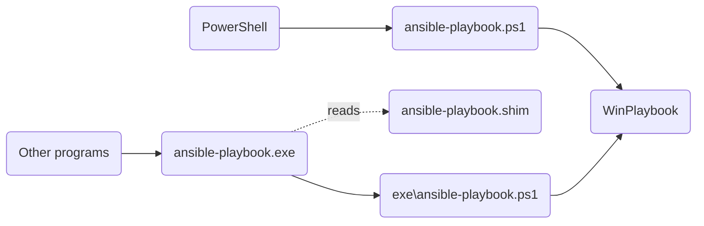
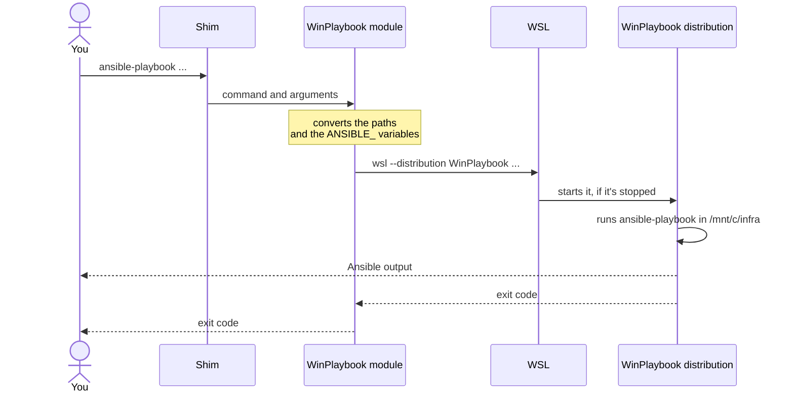

# How WinPlaybook works

WinPlaybook runs Ansible in its own WSL distribution and adds its commands to
your Windows `PATH`. This page shows the parts and what happens to a command,
from installation to the run. To understand why it works this way, see
[Why WinPlaybook](why-winplaybook.md).


## Components

- **PowerShell module**: the `WinPlaybook` module, from the PowerShell
  Gallery. During installation, it prepares the distribution and creates the
  commands. After that, it sends each command to the distribution through
  `Invoke-WinPlaybook`, which can also run any other command in it.
- **WSL distribution**: `WinPlaybook`, with Debian, created by
  `Install-WinPlaybook`. It has Ansible, `ansible-lint`, and `pywinrm`, to
  manage Windows machines. WinPlaybook doesn't use the distributions that you
  already have.
- **Shims**: one for each Ansible command. They receive the call from Windows
  and pass it to the module.

## The distribution

`Install-WinPlaybook` creates the distribution with Debian from the WSL
catalog, with its disk in `C:\Users\<user>\AppData\Local\WinPlaybook\distro`,
and prepares it for Ansible:

- It installs Python, Git, SSH, `sshpass`, and `rsync`, which
  `ansible.posix.synchronize` uses.
- It creates the `winplaybook` user, which runs the commands.
- It installs Ansible with [uv](https://docs.astral.sh/uv/), in
  `/home/winplaybook/.local/bin`, on the newest Python version where Ansible
  works.
- It mounts the Windows drives with `755` folders and `644` files, like a
  Linux disk. This way, Ansible reads the `ansible.cfg` file of the project,
  which it ignores in a folder that everyone can write to.
- It keeps the Windows `Path` out of the distribution `PATH`, so the
  distribution doesn't run the WinPlaybook shims or a Windows program with the
  same name as a Linux command.

The collections and roles that `ansible-galaxy` installs go to
`/home/winplaybook/.ansible`, on the distribution disk, and stay there between
runs. On Windows, this folder is at
`\\wsl.localhost\WinPlaybook\home\winplaybook\.ansible`.

If you run `Install-WinPlaybook` again, it keeps the distribution and
everything in it, such as the collections, and reinstalls Ansible and the
shims.

## Shims

A shim is an executable that passes a call to another program. The WinPlaybook
shims are in `C:\Users\<user>\AppData\Local\WinPlaybook\bin`, which is in the
user `PATH`. `Install-WinPlaybook` creates one for each Ansible command that it
finds in the distribution.

How the call reaches the module depends on the program that runs the command.
PowerShell runs the `.ps1` file directly; other programs go through the `.exe`
file:



Each command has these files in the folder:

- `ansible-playbook.ps1`: the script that PowerShell runs. It loads the module
  and passes it the command name, the arguments, and the pipeline input. At
  the end, it returns the exit code of the command.
- `ansible-playbook.exe`: the executable for other programs, such as Command
  Prompt, editors, and scripts in other languages, which can't run `.ps1`
  files. `Install-WinPlaybook` builds it with the .NET Framework C# compiler,
  which comes with Windows. It starts PowerShell with
  `exe\ansible-playbook.ps1` and passes on the input, the output, and the exit
  code.
- `ansible-playbook.shim`: the configuration of the `.exe` file. When the
  `.exe` file runs, it reads this file to know which PowerShell to start and
  which arguments to use:

    ```text
    path = C:\Program Files\PowerShell\7\pwsh.exe
    args = -NoProfile -ExecutionPolicy Bypass -File "C:\Users\<user>\AppData\Local\WinPlaybook\bin\exe\ansible-playbook.ps1"
    ```

- `exe\ansible-playbook.ps1`: the script that the `.exe` file starts. The
  `.exe` file encodes the arguments, so PowerShell doesn't interpret any of
  them, and the script decodes them before it calls the module.

By default, the `.shim` file uses the PowerShell where `Install-WinPlaybook`
ran. To use another one, pass the `-PowerShell` parameter during
installation.

!!! tip

    Windows PowerShell 5.1 starts faster than PowerShell 7:
    `Install-WinPlaybook -PowerShell Desktop`.

## What happens when you run a command

In the following example, the command runs in `C:\infra`:

```powershell
PS C:\infra> ansible-playbook -i .\inventory\prod.yml .\playbooks\site.yml
```



The distribution can see all the Windows drives, at `/mnt/c`, `/mnt/d`, and
so on. The command runs in the distribution folder that matches the current
folder of the terminal, so relative paths work the same as on Windows. The
arguments reach the command as PowerShell passed them, and no Linux shell
interprets quotes, `$`, or `*`.

When nothing comes through the pipeline, the command reads from the terminal,
and the Ansible password prompts, such as the ones for `--ask-vault-pass` and
`--ask-become-pass`, work the same as on Linux.

## Path conversion

The Linux system in the distribution doesn't understand Windows paths. Before
it calls the command, WinPlaybook changes the arguments that are Windows paths
to the Linux format and leaves the other arguments unchanged. Each path still
points to the same file, now seen from inside the distribution:

- A path with a drive letter goes to the folder of that drive in `/mnt`.
- A path on the distribution disk, in `\\wsl.localhost\WinPlaybook\`, becomes
  its Linux path.
- A relative path with `\` changes to `/` when it starts with `.\` or `..\`,
  or when its folder exists, even if the file doesn't exist yet.

This also applies to a path after an option with `=` or after `@`.

Examples with the current folder in `C:\infra`, which has the `vars` and
`output` folders:

| Argument                                             | In the distribution                  |
| ---------------------------------------------------- | ------------------------------------ |
| `.\playbooks\site.yml`                               | `./playbooks/site.yml`               |
| `C:\infra\inventory\prod.yml`                        | `/mnt/c/infra/inventory/prod.yml`    |
| `D:\other\hosts.yml`                                 | `/mnt/d/other/hosts.yml`             |
| `--inventory=C:\infra\hosts.yml`                     | `--inventory=/mnt/c/infra/hosts.yml` |
| `@vars\prod.yml`                                     | `@vars/prod.yml`                     |
| `output\report.json`, which doesn't exist yet        | `output/report.json`                 |
| `\\wsl.localhost\WinPlaybook\home\winplaybook\a.yml` | `/home/winplaybook/a.yml`            |
| `~web\d+`                                            | `~web\d+`, not a path                |

## Environment variables

The Windows variables that start with `ANSIBLE_`, such as `ANSIBLE_CONFIG`,
reach the command with their paths converted by the same rules as the
arguments. A list separated by `;`, like the Windows lists, becomes a list
separated by `:`, like the Linux lists:

| Variable             | On Windows             | In the distribution         |
| -------------------- | ---------------------- | --------------------------- |
| `ANSIBLE_CONFIG`     | `C:\infra\ansible.cfg` | `/mnt/c/infra/ansible.cfg`  |
| `ANSIBLE_ROLES_PATH` | `C:\roles;D:\roles`    | `/mnt/c/roles:/mnt/d/roles` |

Other variables reach the command only when they're in
[`WSLENV`](https://learn.microsoft.com/windows/wsl/filesystems#share-environment-variables-between-windows-and-wsl-with-wslenv),
as in any WSL distribution. An `ANSIBLE_` variable that's already in `WSLENV`
arrives the way `WSLENV` defines, without the WinPlaybook conversion.

## SSH

The Windows `.ssh` folder, in `C:\Users\<user>\.ssh`, is the `~/.ssh` folder
of the distribution. The SSH client that Ansible uses has the same keys,
`known_hosts` file, and `config` file as Windows, without copies. In the
distribution, the folder has the permissions that SSH requires, and the
permissions of the files on Windows don't change.

The SSH client of the distribution writes new hosts to `known_hosts` without
a hash, like the Windows SSH client, so the file keeps a single format. To
write hashed entries from both, set `HashKnownHosts yes` in the `config` file
of the `.ssh` folder.

If the `.ssh` folder didn't exist during installation, the distribution uses
its own folder. Run `Install-WinPlaybook` again after you create it.

## Limitations

- SSH keys with a passphrase don't work: the Windows SSH agent doesn't reach
  the distribution, and Ansible doesn't answer the passphrase prompt of the
  key.
- Files on the Windows drives can't run as programs in the distribution. An
  inventory script or a vault password script stored on them is read as text,
  and Windows programs don't run from inside the distribution.
- Access to files on the Windows drives is slower than access to the
  distribution disk, which matters in projects with many files.
- Each command goes through WSL, and the `.exe` shims also start PowerShell.
  This adds time to the start of each run, and more when the distribution is
  stopped.
