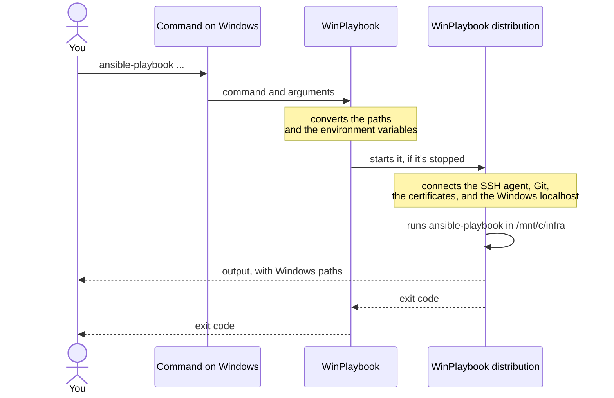

# How WinPlaybook works

Ansible doesn't run on Windows. WinPlaybook installs it on a Linux that runs
inside Windows itself, through WSL, and bridges the two sides. This page shows
the pieces and the path of a command. The other pages in this section explain
each bridge.


## The pieces

<div class="grid cards" markdown>

-   :lucide-package: **The PowerShell module**

    ---

    From the PowerShell Gallery. It installs everything and, for each
    command, prepares the environment and takes the command to Linux.

-   :lucide-server: **The `WinPlaybook` WSL distribution**

    ---

    A Debian that belongs only to WinPlaybook, with Ansible, `ansible-lint`,
    `ansible-creator`, and `pywinrm`. Your WSL distributions aren't used.

-   :lucide-terminal: **The commands on Windows**

    ---

    One for each Ansible command, in
    `C:\Users\<user>\AppData\Local\WinPlaybook\bin`, which is in `PATH`.

</div>

---

## The distribution

`Install-WinPlaybook` creates the distribution with Debian and prepares it:

- installs Ansible with [uv](https://docs.astral.sh/uv/), on the latest Python
  that it works with, and the tools that it uses, such as git, ssh, and
  `rsync`;
- links the user folders to the Windows ones: the Linux `.ssh` and `.ansible`
  are the ones in your profile;
- mounts the Windows drives in a way that lets Ansible accept the
  `ansible.cfg` file in project folders.

Running `Install-WinPlaybook` again keeps the distribution and reinstalls
Ansible and the commands.

---

## The commands on Windows

Each Ansible command has two files in the commands folder:

- a `.ps1` file, which PowerShell runs directly;
- an `.exe` file, for the other programs, such as Command Prompt and editors,
  which opens PowerShell and passes on the input, the output, and the exit
  code.

The `.exe` file opens Windows PowerShell 5.1, which comes with every Windows
and opens faster than PowerShell 7. To use PowerShell 7, run
`Install-WinPlaybook -PowerShell Core`.

---

## The path of a command

In the example, the command runs in `C:\infra`:

```powershell
PS C:\infra> ansible-playbook -i .\inventory\prod.yml .\playbooks\site.yml
```



1. The command runs in the distribution folder that matches the current
   terminal folder, so relative paths work as on Windows.
2. The arguments reach Ansible as PowerShell passed them, without a Linux
   shell interpreting the quotes, `$`, or `*`. Only the Windows paths change.
   See [Paths between Windows and Linux](paths.md).
3. Before Ansible starts, WinPlaybook turns on the bridges that only exist
   during the command, such as the SSH agent and the Windows `localhost`. See
   [Network](network.md) and [Credentials](credentials.md).
4. Ansible password prompts, such as the ones from `--ask-vault-pass`, work in
   the terminal, as on Linux.
5. At the end, the Ansible exit code goes back to Windows, in
   `$LASTEXITCODE`.
