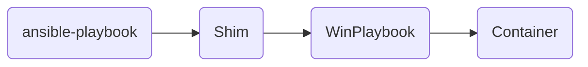
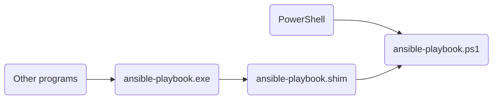

# How WinPlaybook works

Ansible [doesn't support Windows as a control node](https://docs.ansible.com/projects/ansible/latest/installation_guide/intro_installation.html#control-node-requirements),
the machine that runs the playbooks. To use Ansible on Windows, the common
options are WSL, a virtual machine, or a Linux server, often with the
[WSL](https://marketplace.visualstudio.com/items?itemName=ms-vscode-remote.remote-wsl)
or
[Dev Containers](https://marketplace.visualstudio.com/items?itemName=ms-vscode-remote.remote-containers)
extension for VS Code.

WinPlaybook runs Ansible in a container and adds its commands to your Windows
`PATH`. The `ansible-playbook` command is available in the terminal and in any
Windows program, the same way as an installed program.



## Why a container

In WSL or a virtual machine, Ansible runs in another system. To use it, you
work in that system and lose the Windows tools that you already use, such as
PowerShell with your modules and profile. Windows programs also can't find the
Ansible commands.

The WSL and Dev Containers extensions move VS Code into Linux, with the Linux
terminal and files. Both problems remain: in VS Code, you're away from your
Windows tools; outside VS Code, Windows programs can't find Ansible.

[Docker Desktop](https://docs.docker.com/desktop/) already runs Linux without
extra setup. The WinPlaybook image includes Ansible, `ansible-lint`, and the
libraries to manage Windows machines. You don't install Python or Ansible on
Windows, and everyone who uses the same image has the same tool versions.

## Shims: Windows commands that call the container

A shim is an executable that passes a call to another program. During
installation, WinPlaybook lists the Ansible commands in the image and creates
a shim for each one in `%LOCALAPPDATA%\WinPlaybook\bin`, the default folder.
WinPlaybook adds this folder to the user `PATH`.

Each command has two files:

- `ansible-playbook.ps1`: the script that PowerShell runs.
- `ansible-playbook.exe`: the executable for other programs, such as Command
  Prompt, editors, and scripts in other languages, which can't run `.ps1`
  files. It's a copy of the [Scoop Shim](https://github.com/ScoopInstaller/Shim):
  it starts PowerShell and runs the `.ps1` file. The `ansible-playbook.shim`
  file, in the same folder, sets which PowerShell to start and which `.ps1`
  file to run.



## What happens when you run a command

Example: a Git repository in `C:\infra`, with the command run from the root.

```powershell
PS C:\infra> ansible-playbook -i .\inventory\prod.yml .\playbooks\site.yml
```

1. The shim calls the WinPlaybook module with the command and its arguments.
2. WinPlaybook finds the project folder: the root of the Git repository that
   contains the current folder, `C:\infra`. Outside a repository, the project
   folder is the current folder.
3. Windows paths in the arguments become container paths:
   `.\inventory\prod.yml` becomes `./inventory/prod.yml`, and an absolute path
   such as `C:\infra\inventory\prod.yml` becomes `/work/inventory/prod.yml`.
4. WinPlaybook runs `docker run` with the project folder mounted at `/work`.
   The working folder in the container matches the current folder: `C:\infra`
   is `/work`, and `C:\infra\playbooks` would be `/work/playbooks`.
5. Ansible runs in the container, and the output appears in the terminal.
6. Docker removes the container, and WinPlaybook returns the exit code of the
   command. This way, scripts and other programs know whether the command
   succeeded.

Each run uses a new container. Only the content of the project folder stays
from one run to the next.

## Limitations

- The container can access only the project folder. A path outside it, such as
  `D:\other\hosts.yml`, causes an error.
- Each command creates a container, which adds 1.5 to 3 seconds to the start
  of each run.
- Docker Desktop must be running.
- A relative path with `\` is converted only if it already exists. WinPlaybook
  checks whether the path exists so that it doesn't change arguments that
  contain `\` but aren't paths, such as a regular expression. For a file that
  the command creates, use `/`:

    ```powershell
    # The output folder exists, but the inventory.json file doesn't exist yet.

    # Doesn't work: the path reaches the container with \, which Linux doesn't
    # use as a folder separator.
    ansible-inventory -i .\inventory\prod.yml --list --output .\output\inventory.json

    # Works: the path is already in the Linux format.
    ansible-inventory -i .\inventory\prod.yml --list --output ./output/inventory.json
    ```
