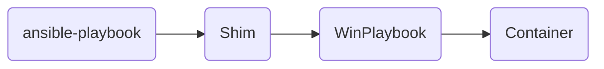
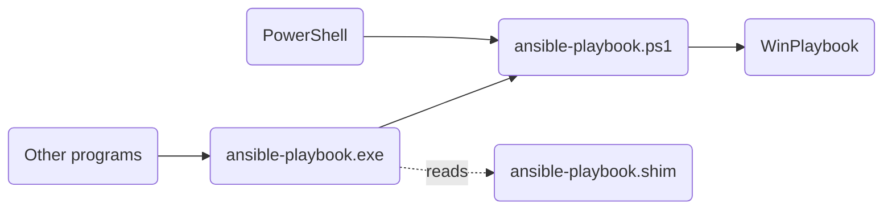
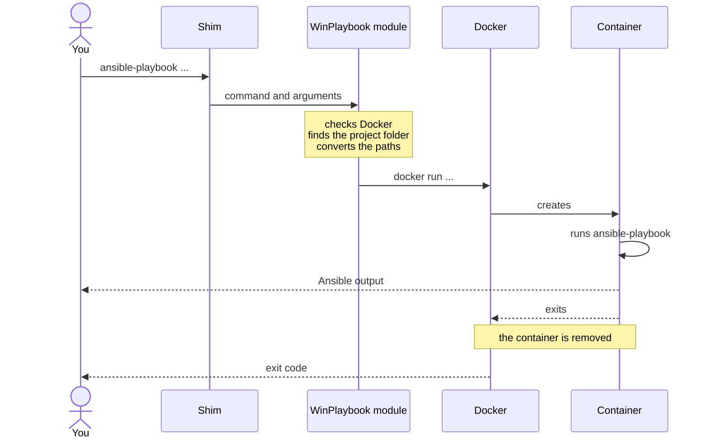

# How WinPlaybook works

WinPlaybook runs Ansible in a disposable container and adds its commands to
your Windows `PATH`. This page shows the parts and what happens to a command,
from installation to the run. To understand why it works this way, see
[Why WinPlaybook](why-winplaybook.md).



## Components

- **PowerShell module**: the `WinPlaybook` module, from the PowerShell
  Gallery. It creates the commands during installation and runs each command
  in the container.
- **Image**: `ghcr.io/leonardosextare/winplaybook`, with Ansible,
  `ansible-lint`, and the libraries to manage Windows machines.
- **Shims**: one for each Ansible command. They receive the call from Windows
  and pass it to the module.

## Shims

A shim is an executable that passes a call to another program. The WinPlaybook
shims are in `C:\Users\<user>\AppData\Local\WinPlaybook\bin`, which is in the
user `PATH`. `Install-WinPlaybookShim` creates them. You run it manually, or
the install script runs it for you.

How the call reaches the module depends on the program that runs the command.
PowerShell runs the `.ps1` file directly; other programs go through the `.exe`
file:



Each command has three files in this folder:

- `ansible-playbook.ps1`: the script that PowerShell runs. It calls the
  module, passing the command name and the arguments. At the end, it returns
  the exit code of the command.
- `ansible-playbook.exe`: the executable for other programs, such as Command
  Prompt, editors, and scripts in other languages, which can't run `.ps1`
  files. It's the [Scoop Shim](https://github.com/ScoopInstaller/Shim), which
  runs the `.ps1` file in PowerShell.
- `ansible-playbook.shim`: the configuration of the `.exe` file. When the
  `.exe` file runs, it reads this file to know which PowerShell to start and
  which arguments to use:

    ```text
    path = C:\Program Files\PowerShell\7\pwsh.exe
    args = -NoProfile -ExecutionPolicy Bypass -File "C:\Users\<user>\AppData\Local\WinPlaybook\bin\ansible-playbook.ps1"
    ```

By default, the `.shim` file uses the PowerShell where
`Install-WinPlaybookShim` ran. To use another one, pass the `-PowerShell`
parameter during installation.

!!! tip

    Windows PowerShell 5.1 starts faster than PowerShell 7.

## What happens when you run a command

In the following example, the command runs from the root of a Git repository
in `C:\infra`:

```powershell
PS C:\infra> ansible-playbook -i .\inventory\prod.yml .\playbooks\site.yml
```



The container can't see the whole disk, only the project folder, which
WinPlaybook mounts at `/work`. In a Git repository, the project folder is the
root of the repository, the same folder that Git shows:

```powershell
PS C:\infra\playbooks> git rev-parse --show-toplevel
C:/infra
```

Because of this, `/work` is always the root of the repository, even when you
run the command from a subfolder. Outside a Git repository, there's no root to
find, and `/work` is the current folder of the terminal.

In the container, the command runs in the folder that matches the current
folder. This way, relative paths work the same as on Windows:

| Current folder       | Git repository | `/work` is         | The command runs in |
| -------------------- | -------------- | ------------------ | ------------------- |
| `C:\infra`           | `C:\infra`     | `C:\infra`         | `/work`             |
| `C:\infra\playbooks` | `C:\infra`     | `C:\infra`         | `/work/playbooks`   |
| `C:\scripts`         | none           | `C:\scripts`       | `/work`             |
| `C:\scripts\linux`   | none           | `C:\scripts\linux` | `/work`             |

Windows paths in the arguments are also converted for the container, as
described in [Path conversion](#path-conversion).

## Path conversion

The Linux system in the container doesn't understand Windows paths. Before it
calls Ansible, WinPlaybook changes the arguments that are file paths to the
Linux format and leaves the other arguments unchanged.

Each path still points to the same file, now seen from inside the container: a
file in the project folder is under `/work`, and a file outside the project
folder causes an error, because the container can't see that folder. This also
applies to a path after an option with `=` or after `@`.

Examples with the project folder and the current folder in `C:\infra`:

| Argument                         | In the container                  |
| -------------------------------- | --------------------------------- |
| `.\playbooks\site.yml`           | `./playbooks/site.yml`            |
| `C:\infra\inventory\prod.yml`    | `/work/inventory/prod.yml`        |
| `D:\other\hosts.yml`             | error: outside the project folder |
| `--inventory=C:\infra\hosts.yml` | `--inventory=/work/hosts.yml`     |
| `@vars\prod.yml`                 | `@vars/prod.yml`                  |
| `~web\d+`                        | `~web\d+`, not a path             |

## Limitations

- Ansible can access only the files in the project folder.
- Each command creates a container, which adds 1.5 to 3 seconds to the start
  of each run.
- Docker Desktop must be running.
