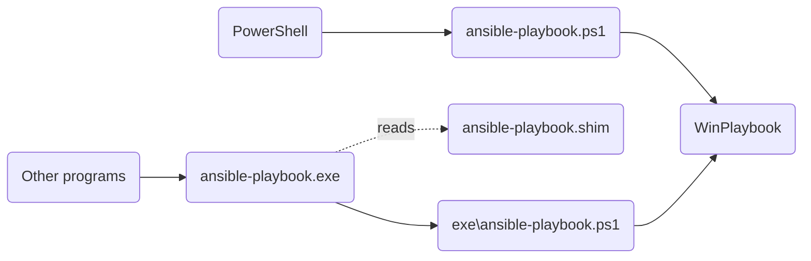
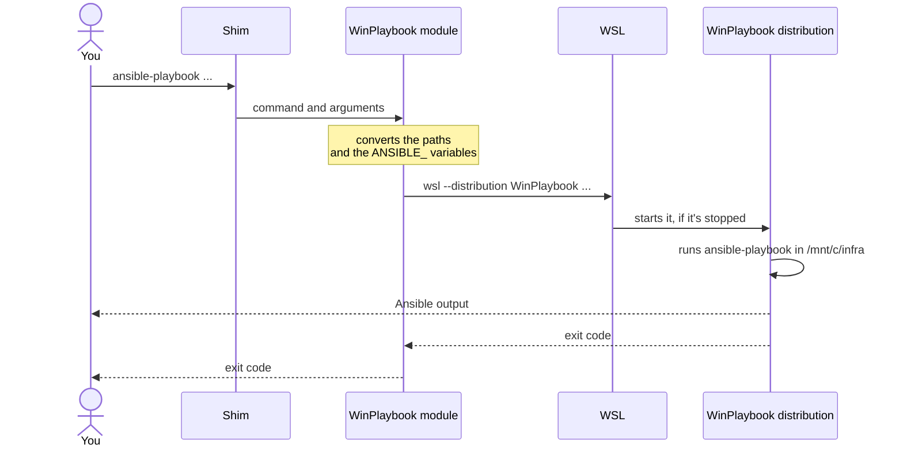

# How WinPlaybook works

WinPlaybook runs Ansible in its own WSL distribution and adds its commands to
your Windows `PATH`. This page shows the parts and what happens to a command,
from installation to the run. To understand why it works this way, see
[Why WinPlaybook](why-winplaybook.md).


## Components

- **PowerShell module**: the `WinPlaybook` module, from the PowerShell
  Gallery. During installation, it prepares the distribution and creates the
  commands. After that, it sends each command to the distribution through
  `Invoke-WinPlaybook`, which can also run any other command in it.
- **WSL distribution**: `WinPlaybook`, with Debian, created by
  `Install-WinPlaybook`. It has Ansible, `ansible-lint`, and `pywinrm`, to
  manage Windows machines. WinPlaybook doesn't use the distributions that you
  already have.
- **Shims**: one for each Ansible command. They receive the call from Windows
  and pass it to the module.

## The distribution

`Install-WinPlaybook` creates the distribution with Debian from the WSL
catalog, with its disk in `C:\Users\<user>\AppData\Local\WinPlaybook\distro`,
and prepares it for Ansible:

- It installs Python, Git, SSH, `sshpass`, `rsync`, which
  `ansible.posix.synchronize` uses, and `socat`, which connects SSH to the
  Windows SSH agent.
- It creates the `winplaybook` user, which runs the commands.
- It installs Ansible with [uv](https://docs.astral.sh/uv/), in
  `/home/winplaybook/.local/bin`, on the newest Python version where Ansible
  works.
- It mounts the Windows drives with `755` folders and `644` files, like a
  Linux disk. This way, Ansible reads the `ansible.cfg` file of the project,
  which it ignores in a folder that everyone can write to.
- It mounts each fixed Windows drive a second time, in
  `/opt/winplaybook/exec`, with permission to run programs, so that Windows
  programs run from inside the distribution.

The programs in your Windows `Path` with the `.com`, `.exe`, `.bat`, and
`.cmd` extensions also work in the commands that Ansible runs, such as an
`ansible.builtin.command` or `ansible.builtin.shell` task. They work by their
full name (`gh.exe`) and by their name without the extension (`gh`), in the
order of `Path` and `PATHEXT`, as on Windows. The distribution commands come
first, so a name that exists on both sides, such as `git` and `ssh`, runs the
distribution command. The WinPlaybook shims stay out, and the Windows Python
and pip work only with the extension (`python.exe`), so that the Ansible
interpreter discovery doesn't choose the Windows Python. The arguments that are
distribution paths, such as `{{ playbook_dir }}`, reach the Windows program as
Windows paths.

A script in the project runs by its extension, as on Windows, without the
Linux execute permission. This way, a vault password file
(`--vault-password-file password.bat`) or a dynamic inventory
(`-i inventory.py`) runs instead of being read as text. `.bat` and `.cmd`
files run with `cmd.exe`, `.exe` and `.com` files run directly, `.ps1` files
run with `powershell.exe`, and `.py` and `.sh` files run with their shebang,
or with the Ansible Python and `sh`. Other files, such as `password.txt`, are
still read as text.

The `git` command of the distribution uses your Windows `.gitconfig` file,
with the same user, aliases, and sign-in: the `credential.helper` of Git for
Windows becomes the Windows Git Credential Manager. This way, `ansible-galaxy`
and the `git` module reach the private repositories that you already use on
Windows.

The `ansible-vault create` and `ansible-vault edit` commands open the editor
in the Windows `EDITOR` variable, such as `code --wait`. Without an `EDITOR`
variable, they open Notepad and wait for you to close the window.

The collections and roles that `ansible-galaxy` installs go to your Windows
profile, in `C:\Users\<user>\.ansible\collections` and
`C:\Users\<user>\.ansible\roles`, as with Ansible installed on Windows.
Ansible also reads `C:\Users\<user>\.ansible.cfg` when the project doesn't
have an `ansible.cfg` file.

Programs in the distribution trust the Windows root certificates, as well as
the Debian ones. This way, on a network that inspects TLS or with an internal
certificate authority installed on Windows, `ansible-galaxy`, the `uri` and
`get_url` modules, `git`, and `pip` work as they do on Windows. If you set
`SSL_CERT_FILE`, `REQUESTS_CA_BUNDLE`, `CURL_CA_BUNDLE`, or `GIT_SSL_CAINFO`
on Windows, the distribution uses your file.

If you run `Install-WinPlaybook` again, it keeps the distribution and
reinstalls Ansible and the shims.

## Shims

A shim is an executable that passes a call to another program. The WinPlaybook
shims are in `C:\Users\<user>\AppData\Local\WinPlaybook\bin`, which is in the
user `PATH`. `Install-WinPlaybook` creates one for each Ansible command that it
finds in the distribution.

How the call reaches the module depends on the program that runs the command.
PowerShell runs the `.ps1` file directly; other programs go through the `.exe`
file:



Each command has these files in the folder:

- `ansible-playbook.ps1`: the script that PowerShell runs. It loads the module
  and passes it the command name, the arguments, and the pipeline input. At
  the end, it returns the exit code of the command.
- `ansible-playbook.exe`: the executable for other programs, such as Command
  Prompt, editors, and scripts in other languages, which can't run `.ps1`
  files. `Install-WinPlaybook` builds it with the .NET Framework C# compiler,
  which comes with Windows. It starts PowerShell with
  `exe\ansible-playbook.ps1` and passes on the input, the output, and the exit
  code.
- `ansible-playbook.shim`: the configuration of the `.exe` file. When the
  `.exe` file runs, it reads this file to know which PowerShell to start and
  which arguments to use:

    ```text
    path = C:\Program Files\PowerShell\7\pwsh.exe
    args = -NoProfile -ExecutionPolicy Bypass -File "C:\Users\<user>\AppData\Local\WinPlaybook\bin\exe\ansible-playbook.ps1"
    ```

- `exe\ansible-playbook.ps1`: the script that the `.exe` file starts. The
  `.exe` file encodes the arguments, so PowerShell doesn't interpret any of
  them, and the script decodes them before it calls the module.

By default, the `.shim` file uses the PowerShell where `Install-WinPlaybook`
ran. To use another one, pass the `-PowerShell` parameter during
installation.

!!! tip

    Windows PowerShell 5.1 starts faster than PowerShell 7:
    `Install-WinPlaybook -PowerShell Desktop`.

## What happens when you run a command

In the following example, the command runs in `C:\infra`:

```powershell
PS C:\infra> ansible-playbook -i .\inventory\prod.yml .\playbooks\site.yml
```



The distribution can see all the Windows drives, at `/mnt/c`, `/mnt/d`, and
so on. The command runs in the distribution folder that matches the current
folder of the terminal, so relative paths work the same as on Windows. The
arguments reach the command as PowerShell passed them, and no Linux shell
interprets quotes, `$`, or `*`.

When nothing comes through the pipeline, the command reads from the terminal,
and the Ansible password prompts, such as the ones for `--ask-vault-pass` and
`--ask-become-pass`, work the same as on Linux.

## Path conversion

The Linux system in the distribution doesn't understand Windows paths. Before
it calls the command, WinPlaybook changes the arguments that are Windows paths
to the Linux format and leaves the other arguments unchanged. Each path still
points to the same file, now seen from inside the distribution:

- A path with a drive letter goes to the folder of that drive in `/mnt`.
- A path on a drive created with `subst` goes to the real folder of the
  drive.
- A network path, or a path on a mapped network drive, goes to
  `/mnt/unc/<server>/<share>`, which the distribution mounts with your
  Windows credentials.
- A path on the distribution disk, in `\\wsl.localhost\WinPlaybook\`, becomes
  its Linux path.
- A relative path with `\` changes to `/` when it starts with `.\` or `..\`,
  or when its folder exists, even if the file doesn't exist yet.

This also applies to a path after an option with `=` or after `@`, and to
the value of a `key=value` pair, such as the ones in `-e` and `-a`
(`-e folder=C:\infra\files`).

Inside the Ansible files, an absolute Windows path also works: in a playbook
variable (`file: C:\infra\files\data.txt`), in the `src` of a `copy` or
`template` task, in a lookup or an `include`, in the inventory, and in the `ansible.cfg`
paths, such as `roles_path`, which can separate several Windows paths with
`;`. The Ansible in the distribution understands these paths by the same
conversion.

On the way back, the output of the Ansible commands shows the paths on the
Windows drives as on Windows, with forward slashes: an error points to
`C:/infra/site.yml`, not to `/mnt/c/infra/site.yml`. The forward slashes
keep JSON output valid, and Windows and VS Code can open these paths.

A script with a shebang (`#!/bin/sh`) and CRLF line endings, like the ones
that Git for Windows writes by default, runs with `ansible.builtin.script`:
Ansible sends a copy without the CR characters, and the project file stays
unchanged.

Examples with the current folder in `C:\infra`, which has the `vars` and
`output` folders:

| Argument                                             | In the distribution                  |
| ---------------------------------------------------- | ------------------------------------ |
| `.\playbooks\site.yml`                               | `./playbooks/site.yml`               |
| `C:\infra\inventory\prod.yml`                        | `/mnt/c/infra/inventory/prod.yml`    |
| `D:\other\hosts.yml`                                 | `/mnt/d/other/hosts.yml`             |
| `\\server\infra\site.yml`                            | `/mnt/unc/server/infra/site.yml`     |
| `--inventory=C:\infra\hosts.yml`                     | `--inventory=/mnt/c/infra/hosts.yml` |
| `@vars\prod.yml`                                     | `@vars/prod.yml`                     |
| `output\report.json`, which doesn't exist yet        | `output/report.json`                 |
| `\\wsl.localhost\WinPlaybook\home\winplaybook\a.yml` | `/home/winplaybook/a.yml`            |
| `~web\d+`                                            | `~web\d+`, not a path                |

## Environment variables

The environment variables of your terminal reach the command, such as
`ANSIBLE_CONFIG`, `HTTPS_PROXY`, and the credentials that collections read,
with their paths converted by the same rules as the arguments. A list
separated by `;`, like the Windows lists, becomes a list separated by `:`,
like the Linux lists:

| Variable             | On Windows             | In the distribution         |
| -------------------- | ---------------------- | --------------------------- |
| `ANSIBLE_CONFIG`     | `C:\infra\ansible.cfg` | `/mnt/c/infra/ansible.cfg`  |
| `ANSIBLE_ROLES_PATH` | `C:\roles;D:\roles`    | `/mnt/c/roles:/mnt/d/roles` |
| `HTTPS_PROXY`        | `http://proxy:8080`    | `http://proxy:8080`         |

The variables that the distribution sets its own way stay out, such as
`PATH`, `HOME`, `TEMP`, and `LANG`, the Python variables, such as
`PYTHONPATH`, and `SSH_AUTH_SOCK`. A variable that's already in
[`WSLENV`](https://learn.microsoft.com/windows/wsl/filesystems#share-environment-variables-between-windows-and-wsl-with-wslenv)
arrives the way `WSLENV` defines, without the WinPlaybook conversion.

## SSH

The Windows `.ssh` folder, in `C:\Users\<user>\.ssh`, is the `~/.ssh` folder
of the distribution. The SSH client that Ansible uses has the same keys,
`known_hosts` file, and `config` file as Windows, without copies. In the
distribution, the folder has the permissions that SSH requires, and the
permissions of the files on Windows don't change.

The SSH client of the distribution writes new hosts to `known_hosts` without
a hash, like the Windows SSH client, so the file keeps a single format. To
write hashed entries from both, set `HashKnownHosts yes` in the `config` file
of the `.ssh` folder.

When the inventory and the `config` file don't set a user for the connection,
the SSH client of the distribution uses your Windows user name, like the
Windows SSH client.

The `config` file can have Windows paths, such as in an `IdentityFile` entry or
in a `ProxyCommand` entry with `ssh.exe`. The SSH client of the distribution uses
a translated copy of it, which it rebuilds on every command, and the Windows
file stays unchanged: a path in the `.ssh` folder becomes the distribution
`~/.ssh` folder, the `IdentityAgent` entry of the Windows agent becomes the
distribution agent, and the `ssh.exe` program in `ProxyCommand` becomes the
SSH client of the distribution.

If the `.ssh` folder doesn't exist yet, `Install-WinPlaybook` creates it
empty, as the Windows SSH client would on first use. Keys that you create
later work right away. `Uninstall-WinPlaybook` deletes this folder only if
it's still empty.

When the Windows SSH agent is on, the SSH client of the distribution uses the
keys in the agent, and a key with a passphrase works without asking for the
passphrase. The distribution can't reach the named pipe of the agent, so each
command opens a socket in Linux, with `socat`, and connects it to the agent
through a relay: a Windows executable that `Install-WinPlaybook` compiles and
stores in `C:\Users\<user>\AppData\Local\WinPlaybook\bin\exe`. The socket
exists only while the command runs. To turn on the agent, see
[Use SSH keys with a passphrase](install.md#use-ssh-keys-with-a-passphrase).

## Limitations

- The files in your project folders can't run as programs in the
  distribution. An inventory script or a vault password script stored in them
  is read as text.
- Access to files on the Windows drives is slower than access to the
  distribution disk, which matters in projects with many files.
- Each command goes through WSL, and the `.exe` shims also start PowerShell.
  This adds time to the start of each run, and more when the distribution is
  stopped.
