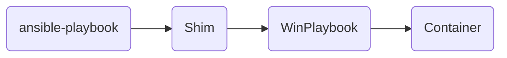
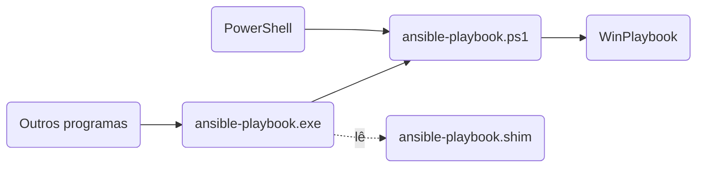
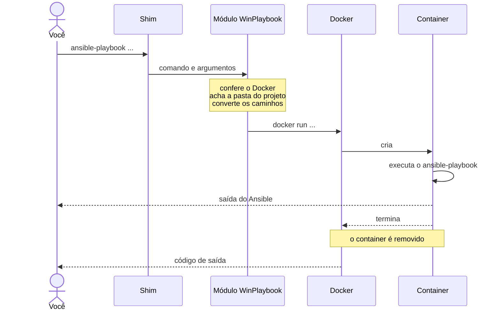

# Como o WinPlaybook funciona

O WinPlaybook roda o Ansible em um *container* descartável e coloca os
comandos dele no `PATH` do Windows. Esta página mostra as peças e o caminho de
um comando, da instalação até a execução. Para entender por que ele foi feito
assim, veja [Por que o WinPlaybook](why-winplaybook.md).



## Componentes

- **Módulo PowerShell**: o módulo `WinPlaybook`, da PowerShell Gallery. Cria
  os comandos na instalação e roda cada execução no *container*.
- **Imagem**: `ghcr.io/leonardosextare/winplaybook`, com o Ansible, o
  `ansible-lint` e as bibliotecas para gerenciar máquinas Windows.
- ***Shims***: um para cada comando do Ansible. Recebem a chamada do Windows e
  a passam para o módulo.

## Shims

Um *shim* é um executável que repassa a chamada para outro programa. Os
*shims* do WinPlaybook ficam em
`C:\Users\<usuário>\AppData\Local\WinPlaybook\bin`, no `PATH` do usuário. Eles
são criados pelo `Install-WinPlaybookShim`, executado manualmente ou pelo
script de instalação.

O caminho até o módulo depende de quem chama o comando. O PowerShell executa
o `.ps1` direto; os outros programas passam pelo `.exe`:



Cada comando tem três arquivos nessa pasta:

- `ansible-playbook.ps1`: o script que o PowerShell executa. Ele chama o
  módulo, passando o nome do comando e os argumentos. No fim, devolve o código
  de saída do comando.
- `ansible-playbook.exe`: o executável para os outros programas, como o
  Prompt de Comando, editores e scripts em outras linguagens, que não
  executam `.ps1`. É o [Shim do Scoop](https://github.com/ScoopInstaller/Shim),
  que executa o `.ps1` no PowerShell.
- `ansible-playbook.shim`: a configuração do `.exe`. Ao ser executado, o
  `.exe` lê esse arquivo para saber qual PowerShell abrir e com quais
  argumentos:

    ```text
    path = C:\Program Files\PowerShell\7\pwsh.exe
    args = -NoProfile -ExecutionPolicy Bypass -File "C:\Users\<usuário>\AppData\Local\WinPlaybook\bin\ansible-playbook.ps1"
    ```

Por padrão, o `.shim` usa o PowerShell em que o `Install-WinPlaybookShim` foi
executado. Para usar outro, passe o parâmetro `-PowerShell` na instalação.

!!! tip "Dica"

    O Windows PowerShell 5.1 abre mais rápido que o PowerShell 7.

## O que acontece quando você executa um comando

No exemplo abaixo, o comando é executado na raiz de um repositório git em
`C:\infra`:

```powershell
PS C:\infra> ansible-playbook -i .\inventory\prod.yml .\playbooks\site.yml
```



O *container* não enxerga o disco inteiro, só a pasta do projeto, que o
WinPlaybook monta em `/work`. Dentro de um repositório git, a pasta do projeto
é a raiz do repositório, a mesma que o git mostra:

```powershell
PS C:\infra\playbooks> git rev-parse --show-toplevel
C:/infra
```

Por isso, `/work` é sempre a raiz do repositório, mesmo quando você executa o
comando numa subpasta. Fora de um repositório git, não há raiz para
encontrar, e `/work` é a pasta atual do terminal.

Dentro do *container*, o comando roda na pasta que corresponde à pasta atual.
Assim, os caminhos relativos funcionam como no Windows:

| Pasta atual          | Repositório git | `/work` é          | O comando roda em |
| -------------------- | --------------- | ------------------ | ----------------- |
| `C:\infra`           | `C:\infra`      | `C:\infra`         | `/work`           |
| `C:\infra\playbooks` | `C:\infra`      | `C:\infra`         | `/work/playbooks` |
| `C:\scripts`         | nenhum          | `C:\scripts`       | `/work`           |
| `C:\scripts\linux`   | nenhum          | `C:\scripts\linux` | `/work`           |

Os caminhos do Windows nos argumentos também são convertidos para o
*container*, conforme as regras de
[Conversão de caminhos](#conversao-de-caminhos).

## Conversão de caminhos

O Linux do *container* não entende caminhos do Windows. Antes de chamar o
Ansible, o WinPlaybook passa para o formato do Linux os argumentos que são
caminhos de arquivo e deixa os outros como estão.

Cada caminho continua apontando para o mesmo arquivo, agora visto de dentro do
*container*: o que está na pasta do projeto fica em `/work`, e o que está fora
dela gera um erro, porque o *container* não enxerga essa pasta. Isso vale
também para um caminho depois de uma opção com `=` ou de um `@`.

Exemplos com a pasta do projeto e a pasta atual em `C:\infra`:

| Argumento                        | No *container*                 |
| -------------------------------- | ------------------------------ |
| `.\playbooks\site.yml`           | `./playbooks/site.yml`         |
| `C:\infra\inventory\prod.yml`    | `/work/inventory/prod.yml`     |
| `D:\outros\hosts.yml`            | erro: fora da pasta do projeto |
| `--inventory=C:\infra\hosts.yml` | `--inventory=/work/hosts.yml`  |
| `@vars\prod.yml`                 | `@vars/prod.yml`               |
| `~web\d+`                        | `~web\d+`, não é caminho       |

## Limitações

- O Ansible só acessa os arquivos da pasta do projeto.
- Cada comando cria um *container*, o que soma de 1,5 a 3 segundos ao início
  de cada execução.
- O Docker Desktop precisa estar em execução.
