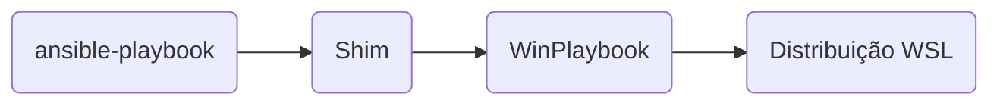
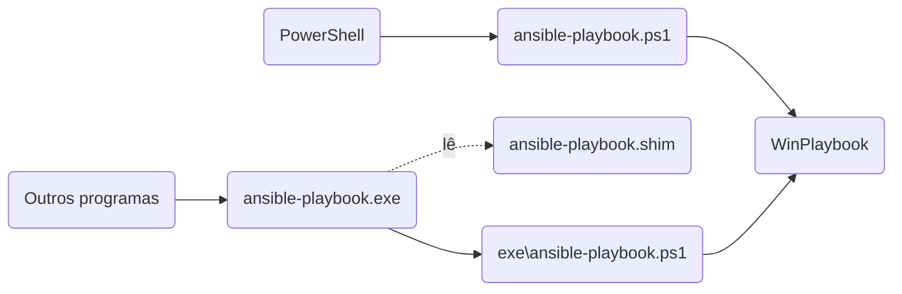
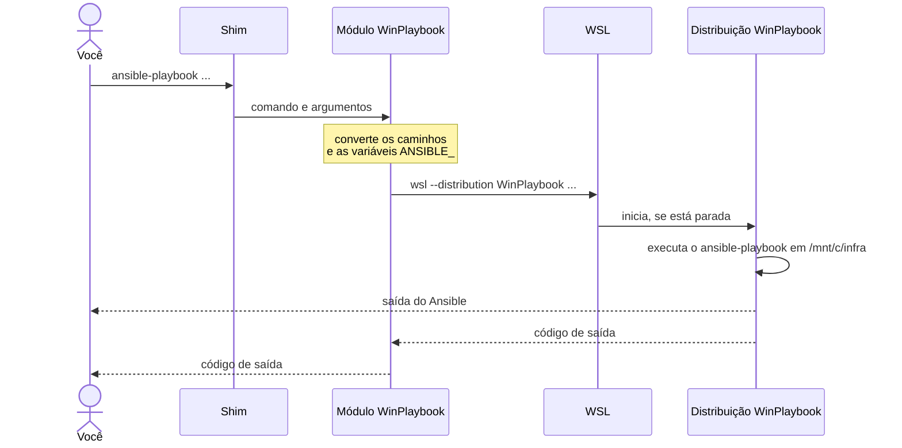

# Como o WinPlaybook funciona

O WinPlaybook roda o Ansible numa distribuição WSL própria e coloca os
comandos dele no `PATH` do Windows. Esta página mostra as peças e o caminho de
um comando, da instalação até a execução. Para entender por que ele foi feito
assim, veja [Por que o WinPlaybook](why-winplaybook.md).



## Componentes

- **Módulo PowerShell**: o módulo `WinPlaybook`, da PowerShell Gallery. Na
  instalação, prepara a distribuição e cria os comandos. Depois, leva cada
  execução para a distribuição, pelo `Invoke-WinPlaybook`, que também executa
  qualquer outro comando dela.
- **Distribuição WSL**: a `WinPlaybook`, com o Debian, criada pelo
  `Install-WinPlaybook`. Tem o Ansible, o `ansible-lint` e o `pywinrm`, para
  gerenciar máquinas Windows. As distribuições que você já tem não são usadas.
- ***Shims***: um para cada comando do Ansible. Recebem a chamada do Windows e
  a passam para o módulo.

## A distribuição

O `Install-WinPlaybook` cria a distribuição com o Debian do catálogo do WSL,
com o disco em `C:\Users\<usuário>\AppData\Local\WinPlaybook\distro`, e a
prepara para o Ansible:

- instala o Python, o git, o ssh, o `sshpass`, o `rsync`, que o
  `ansible.posix.synchronize` usa, e o `socat`, que liga o ssh ao agente SSH
  do Windows;
- cria o usuário `winplaybook`, que executa os comandos;
- instala o Ansible com o [uv](https://docs.astral.sh/uv/), em
  `/home/winplaybook/.local/bin`, no Python mais novo em que ele funciona;
- monta as unidades do Windows com pastas `755` e arquivos `644`, como num
  disco do Linux. Assim o Ansible lê o `ansible.cfg` do projeto, que ele
  ignora numa pasta em que todos podem escrever;
- monta cada unidade fixa do Windows uma segunda vez, em
  `/opt/winplaybook/exec`, com permissão de execução, para os programas do
  Windows rodarem de dentro da distribuição.

Os programas do seu `Path` do Windows, com as extensões `.com`, `.exe`,
`.bat` e `.cmd`, também funcionam nos comandos que o Ansible executa, como
numa tarefa `ansible.builtin.command` ou `ansible.builtin.shell`. Eles
funcionam pelo nome completo (`gh.exe`) e pelo nome sem a extensão (`gh`),
na ordem do `Path` e do `PATHEXT`, como no Windows. Os comandos da
distribuição vêm primeiro, então um nome que existe nos dois lados, como o
`git` e o `ssh`, executa o da distribuição. Os _shims_ do WinPlaybook ficam
de fora, e o Python e o pip do Windows só funcionam com a extensão
(`python.exe`), para a detecção de interpretador do Ansible não escolher o
Python do Windows.

As _collections_ e as _roles_ que o `ansible-galaxy` instala ficam no seu
perfil do Windows, em `C:\Users\<usuário>\.ansible\collections` e
`C:\Users\<usuário>\.ansible\roles`, como num Ansible instalado no Windows. O
Ansible também lê o `C:\Users\<usuário>\.ansible.cfg`, quando o projeto não
tem um `ansible.cfg`.

Executar o `Install-WinPlaybook` de novo mantém a distribuição e reinstala o
Ansible e os _shims_.

## Shims

Um _shim_ é um executável que repassa a chamada para outro programa. Os
_shims_ do WinPlaybook ficam em
`C:\Users\<usuário>\AppData\Local\WinPlaybook\bin`, no `PATH` do usuário. O
`Install-WinPlaybook` cria um para cada comando do Ansible que encontra na
distribuição.

O caminho até o módulo depende de quem chama o comando. O PowerShell executa
o `.ps1` direto; os outros programas passam pelo `.exe`:



Cada comando tem estes arquivos na pasta:

- `ansible-playbook.ps1`: o _script_ que o PowerShell executa. Ele carrega o
  módulo e passa para ele o nome do comando, os argumentos e o que chega pelo
  _pipeline_. No fim, devolve o código de saída do comando.
- `ansible-playbook.exe`: o executável para os outros programas, como o
  Prompt de Comando, editores e _scripts_ em outras linguagens, que não
  executam `.ps1`. O `Install-WinPlaybook` faz o _build_ dele com o compilador
  de C# do .NET Framework, que vem no Windows. Ele abre o PowerShell com o
  `exe\ansible-playbook.ps1` e repassa a entrada, a saída e o código de saída.
- `ansible-playbook.shim`: a configuração do `.exe`. Ao ser executado, o
  `.exe` lê esse arquivo para saber qual PowerShell abrir e com quais
  argumentos:

    ```text
    path = C:\Program Files\PowerShell\7\pwsh.exe
    args = -NoProfile -ExecutionPolicy Bypass -File "C:\Users\<usuário>\AppData\Local\WinPlaybook\bin\exe\ansible-playbook.ps1"
    ```

- `exe\ansible-playbook.ps1`: o _script_ que o `.exe` abre. O `.exe` passa os
  argumentos codificados, para que o PowerShell não interprete nenhum deles,
  e o _script_ os decodifica antes de chamar o módulo.

Por padrão, o `.shim` usa o PowerShell em que o `Install-WinPlaybook` foi
executado. Para usar outro, passe o parâmetro `-PowerShell` na instalação.

!!! tip "Dica"

    O Windows PowerShell 5.1 abre mais rápido que o PowerShell 7:
    `Install-WinPlaybook -PowerShell Desktop`.

## O que acontece quando você executa um comando

No exemplo abaixo, o comando é executado em `C:\infra`:

```powershell
PS C:\infra> ansible-playbook -i .\inventory\prod.yml .\playbooks\site.yml
```



A distribuição enxerga todas as unidades do Windows, em `/mnt/c`, `/mnt/d` e
assim por diante. O comando roda na pasta da distribuição que corresponde à
pasta atual do terminal, então os caminhos relativos funcionam como no
Windows. Os argumentos chegam ao comando como o PowerShell os passou, sem que
um _shell_ do Linux interprete as aspas, o `$` ou o `*`.

Quando nada chega pelo _pipeline_, o comando lê o terminal, e os pedidos de
senha do Ansible, como os do `--ask-vault-pass` e do `--ask-become-pass`,
funcionam como no Linux.

## Conversão de caminhos

O Linux da distribuição não entende caminhos do Windows. Antes de chamar o
comando, o WinPlaybook passa para o formato do Linux os argumentos que são
caminhos do Windows e deixa os outros como estão. Cada caminho continua
apontando para o mesmo arquivo, agora visto de dentro da distribuição:

- um caminho com a letra da unidade vai para a pasta dela em `/mnt`;
- um caminho numa unidade criada com o `subst` vai para a pasta real dela;
- um caminho de rede, ou numa unidade de rede mapeada, vai para
  `/mnt/unc/<servidor>/<compartilhamento>`, que a distribuição monta com as
  suas credenciais do Windows;
- um caminho do disco da distribuição, em `\\wsl.localhost\WinPlaybook\`,
  vira o caminho dele no Linux;
- um caminho relativo com `\` passa a usar `/` quando começa com `.\` ou
  `..\`, ou quando a pasta dele existe, mesmo que o arquivo ainda não exista.

Isso vale também para um caminho depois de uma opção com `=` ou de um `@`,
e para o valor de um `chave=valor`, como os do `-e` e do `-a`
(`-e pasta=C:\infra\files`).

Dentro dos arquivos do Ansible, um caminho absoluto do Windows também
funciona: numa variável do _playbook_ (`arquivo: C:\infra\files\dado.txt`),
no `src` de um `copy` ou `template`, num _lookup_ ou `include`, no inventário e nos
caminhos do `ansible.cfg`, como o `roles_path`, que pode separar vários
caminhos do Windows por `;`. O Ansible da distribuição entende esses
caminhos pela mesma conversão.

Exemplos com a pasta atual em `C:\infra`, que tem as pastas `vars` e
`saida`:

| Argumento                                            | Na distribuição                      |
| ---------------------------------------------------- | ------------------------------------ |
| `.\playbooks\site.yml`                               | `./playbooks/site.yml`               |
| `C:\infra\inventory\prod.yml`                        | `/mnt/c/infra/inventory/prod.yml`    |
| `D:\outros\hosts.yml`                                | `/mnt/d/outros/hosts.yml`            |
| `\\servidor\infra\site.yml`                          | `/mnt/unc/servidor/infra/site.yml`   |
| `--inventory=C:\infra\hosts.yml`                     | `--inventory=/mnt/c/infra/hosts.yml` |
| `@vars\prod.yml`                                     | `@vars/prod.yml`                     |
| `saida\relatorio.json`, que ainda não existe         | `saida/relatorio.json`               |
| `\\wsl.localhost\WinPlaybook\home\winplaybook\a.yml` | `/home/winplaybook/a.yml`            |
| `~web\d+`                                            | `~web\d+`, não é caminho             |

## Variáveis de ambiente

As variáveis de ambiente do terminal chegam ao comando, como o
`ANSIBLE_CONFIG`, o `HTTPS_PROXY` e as credenciais que as _collections_ leem,
com os caminhos convertidos pelas mesmas regras dos argumentos. Uma lista
separada por `;`, como as do Windows, vira uma lista separada por `:`, como
as do Linux:

| Variável              | No Windows             | Na distribuição             |
| --------------------- | ---------------------- | --------------------------- |
| `ANSIBLE_CONFIG`      | `C:\infra\ansible.cfg` | `/mnt/c/infra/ansible.cfg`  |
| `ANSIBLE_ROLES_PATH`  | `C:\roles;D:\roles`    | `/mnt/c/roles:/mnt/d/roles` |
| `HTTPS_PROXY`         | `http://proxy:8080`    | `http://proxy:8080`         |

Ficam de fora as variáveis que a distribuição define do próprio jeito, como
o `PATH`, o `HOME`, o `TEMP` e o `LANG`, as do Python, como o `PYTHONPATH`, e
o `SSH_AUTH_SOCK`. Uma variável que já está no
[`WSLENV`](https://learn.microsoft.com/windows/wsl/filesystems#share-environment-variables-between-windows-and-wsl-with-wslenv)
chega do jeito que o `WSLENV` define, sem a conversão do WinPlaybook.

## SSH

A pasta `.ssh` do Windows, em `C:\Users\<usuário>\.ssh`, é o `~/.ssh` da
distribuição. O ssh do Ansible usa as mesmas chaves, o mesmo `known_hosts` e
o mesmo `config` do Windows, sem cópias. Dentro da distribuição, a pasta
aparece com as permissões que o ssh exige, sem mudar as permissões dos
arquivos no Windows.

O ssh da distribuição grava os hosts novos no `known_hosts` sem _hash_, como
o ssh do Windows, então o arquivo fica num formato só. Para gravar com _hash_
nos dois, use `HashKnownHosts yes` no `config` da pasta `.ssh`.

Quando o inventário e o `config` não definem um usuário para a conexão, o ssh
da distribuição usa o seu nome de usuário do Windows, como o ssh do Windows.

O `config` pode ter caminhos do Windows, como num `IdentityFile` ou num
`ProxyCommand` com o `ssh.exe`. O ssh da distribuição usa uma cópia traduzida
dele, refeita a cada comando, e o arquivo do Windows fica como está: um
caminho da pasta `.ssh` vira o `~/.ssh` da distribuição, o `IdentityAgent`
do agente do Windows vira o agente da distribuição, e o `ssh.exe` do
`ProxyCommand` vira o ssh da distribuição.

Se a pasta `.ssh` ainda não existe, o `Install-WinPlaybook` a cria vazia,
como o ssh do Windows faria no primeiro uso. As chaves que você criar depois
funcionam na hora. O `Uninstall-WinPlaybook` apaga essa pasta só se ela
continuar vazia.

Quando o agente SSH do Windows está ligado, o ssh da distribuição usa as
chaves que estão nele, e uma chave com passphrase funciona sem pedir a
passphrase. A distribuição não alcança o _named pipe_ do agente, então cada
comando abre um _socket_ no Linux, com o `socat`, e o liga ao agente por um
_relay_: um executável do Windows que o `Install-WinPlaybook` compila e guarda
em `C:\Users\<usuário>\AppData\Local\WinPlaybook\bin\exe`. O _socket_ existe
só enquanto o comando roda. Para ligar o agente, veja
[Usar chaves SSH com passphrase](install.md#usar-chaves-ssh-com-passphrase).

## Limitações

- Os arquivos das pastas dos seus projetos não são executáveis na
  distribuição. Um _script_ de inventário ou de senha do vault guardado
  nelas é lido como texto.
- O acesso aos arquivos das unidades do Windows é mais lento que ao disco da
  distribuição, o que pesa em projetos com muitos arquivos.
- Cada comando passa pelo WSL, e os _shims_ `.exe` abrem também um
  PowerShell. Isso soma um tempo ao início de cada execução, maior quando a
  distribuição está parada.
