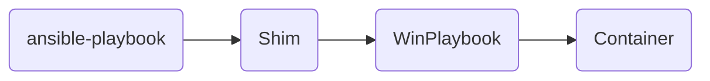
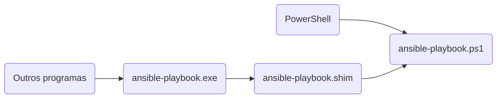

# Como o WinPlaybook funciona

O Ansible [não tem suporte ao Windows como máquina de controle](https://docs.ansible.com/projects/ansible/latest/installation_guide/intro_installation.html#control-node-requirements),
a máquina de onde os *playbooks* são executados. Para usar o Ansible no
Windows, as opções comuns são o WSL, uma máquina virtual ou um servidor
Linux, muitas vezes com as extensões
[WSL](https://marketplace.visualstudio.com/items?itemName=ms-vscode-remote.remote-wsl)
ou
[Dev Containers](https://marketplace.visualstudio.com/items?itemName=ms-vscode-remote.remote-containers)
do VS Code.

O WinPlaybook roda o Ansible em um *container* e coloca os comandos dele no
`PATH` do Windows. O `ansible-playbook` fica disponível no terminal e em
qualquer programa do Windows, como um programa instalado.



## Por que um container

No WSL ou numa máquina virtual, o Ansible fica em outro sistema. Para usá-lo,
você trabalha nesse sistema e perde as ferramentas do Windows com que já
trabalhava, como o PowerShell com os módulos e o perfil configurados. Os
programas do Windows também não encontram os comandos do Ansible.

As extensões WSL e Dev Containers levam o VS Code para dentro do Linux, com o
terminal e os arquivos de lá. Os dois problemas continuam: no VS Code, você
fica longe das ferramentas do Windows; fora dele, os programas do Windows não
encontram o Ansible.

O [Docker Desktop](https://docs.docker.com/desktop/) já roda Linux sem
configuração extra. A imagem do WinPlaybook traz o Ansible, o `ansible-lint` e
as bibliotecas para gerenciar máquinas Windows. Você não instala o Python nem
o Ansible no Windows, e as versões das ferramentas são as mesmas para todos
que usam a mesma imagem.

## Shims: comandos do Windows que chamam o container

Um *shim* é um executável que repassa a chamada para outro programa. Na
instalação, o WinPlaybook lista os comandos do Ansible da imagem e cria um
*shim* para cada um em `%LOCALAPPDATA%\WinPlaybook\bin`, a pasta padrão. Essa
pasta entra no `PATH` do usuário.

Cada comando tem dois arquivos:

- `ansible-playbook.ps1`: o script que o PowerShell executa.
- `ansible-playbook.exe`: o executável para os outros programas, como o
  Prompt de Comando, editores e scripts em outras linguagens, que não
  executam `.ps1`. É uma cópia do [Shim do Scoop](https://github.com/ScoopInstaller/Shim):
  ele abre o PowerShell e executa o `.ps1`. O arquivo `ansible-playbook.shim`,
  na mesma pasta, define qual PowerShell abrir e qual `.ps1` executar.



## O que acontece quando você executa um comando

Exemplo: um repositório git em `C:\infra`, com o comando executado na raiz.

```powershell
PS C:\infra> ansible-playbook -i .\inventory\prod.yml .\playbooks\site.yml
```

1. O *shim* chama o módulo WinPlaybook com o comando e os argumentos.
2. O WinPlaybook define a pasta do projeto: a raiz do repositório git que
   contém a pasta atual, `C:\infra`. Fora de um repositório, a pasta do
   projeto é a própria pasta atual.
3. Os caminhos do Windows nos argumentos viram caminhos do *container*:
   `.\inventory\prod.yml` vira `./inventory/prod.yml`, e um caminho absoluto
   como `C:\infra\inventory\prod.yml` vira `/work/inventory/prod.yml`.
4. O WinPlaybook executa `docker run` com a pasta do projeto montada em
   `/work`. A pasta de trabalho no *container* corresponde à pasta atual:
   `C:\infra` é `/work`, e `C:\infra\playbooks` seria `/work/playbooks`.
5. O Ansible roda no *container*, e a saída aparece no terminal.
6. O Docker remove o *container*, e o WinPlaybook devolve o código de saída
   do comando. Assim, scripts e outros programas sabem se o comando deu certo.

Cada execução usa um *container* novo. Só o que está na pasta do projeto
permanece de uma execução para outra.

## Limitações

- O *container* só acessa a pasta do projeto. Um caminho fora dela, como
  `D:\outros\hosts.yml`, gera um erro.
- Cada comando cria um *container*, o que soma de 1,5 a 3 segundos ao início
  de cada execução.
- O Docker Desktop precisa estar rodando.
- Um caminho relativo com `\` só é convertido quando já existe. O WinPlaybook
  confere se o caminho existe para não alterar argumentos que têm `\` mas não
  são caminhos, como uma expressão regular. Para um arquivo que o comando
  ainda vai criar, use `/`:

    ```powershell
    # A pasta saida existe, mas o arquivo inventario.json ainda não.

    # Não funciona: o caminho chega ao container com \, que o Linux não usa
    # como separador de pastas.
    ansible-inventory -i .\inventory\prod.yml --list --output .\saida\inventario.json

    # Funciona: o caminho já está no formato do Linux.
    ansible-inventory -i .\inventory\prod.yml --list --output ./saida/inventario.json
    ```
