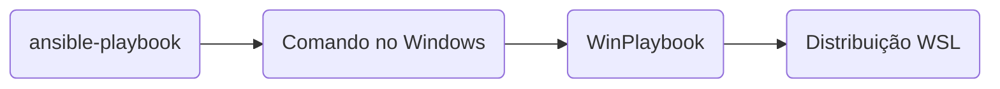
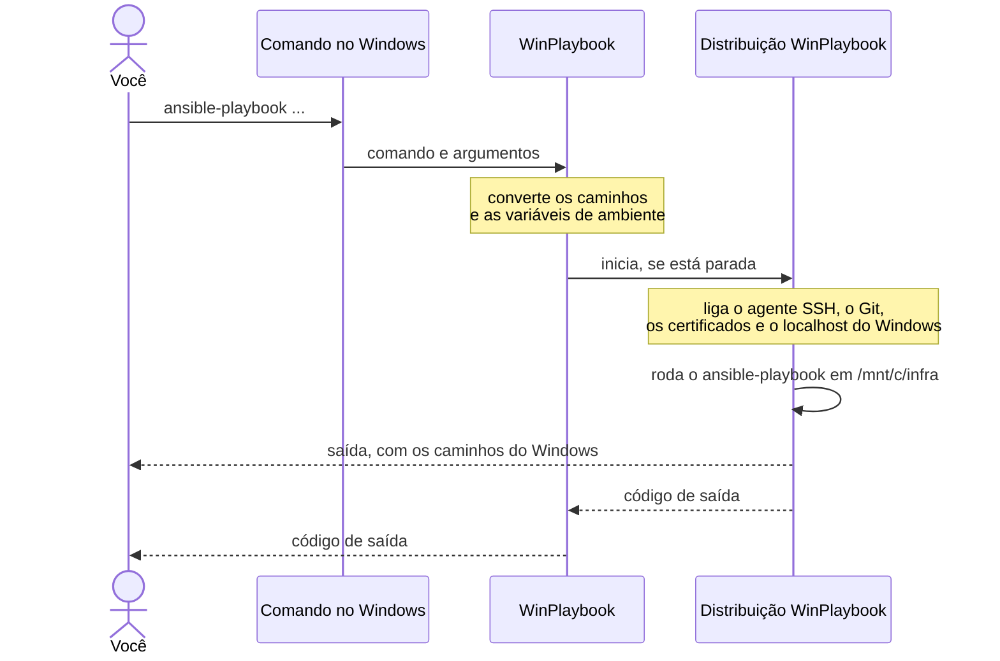

# Como o WinPlaybook funciona

O Ansible não roda no Windows. O WinPlaybook instala o Ansible num Linux que
roda dentro do próprio Windows, pelo WSL, e faz a ponte entre os dois sistemas. Esta
página mostra as peças e o caminho de um comando. As outras páginas desta
seção explicam cada parte em detalhe.



## As peças

<div class="grid cards" markdown>

-   :lucide-package: **O módulo PowerShell**

    ---

    Vem da PowerShell Gallery. Instala tudo e, a cada comando, prepara o
    ambiente e leva o comando para o Linux.

-   :lucide-server: **A distribuição WSL `WinPlaybook`**

    ---

    Um Debian que é só do WinPlaybook, com o Ansible, o `ansible-lint` e o
    `pywinrm`. As suas distribuições WSL não são usadas.

-   :lucide-terminal: **Os comandos no Windows**

    ---

    Um para cada comando do Ansible, em
    `C:\Users\<usuário>\AppData\Local\WinPlaybook\bin`, que fica no `PATH`.

</div>

---

## A distribuição

O `Install-WinPlaybook` cria a distribuição com o Debian e a prepara:

- instala o Ansible com o [uv](https://docs.astral.sh/uv/), no Python mais
  novo em que ele funciona, e as ferramentas que ele usa, como o git, o ssh e
  o `rsync`;
- liga as pastas do usuário no Linux, como a `.ssh` e a `.ansible`, às
  pastas do seu perfil do Windows;
- monta as unidades do Windows de forma que o Ansible aceite o `ansible.cfg`
  das pastas dos projetos.

Rodar o `Install-WinPlaybook` de novo mantém a distribuição e reinstala o
Ansible e os comandos.

---

## Os comandos no Windows

Cada comando do Ansible tem dois arquivos na pasta dos comandos:

- um `.ps1`, que o PowerShell executa direto;
- um `.exe`, para os outros programas, como o Prompt de Comando e os editores,
  que abre um PowerShell e repassa a entrada, a saída e o código de saída.

O `.exe` usa o mesmo PowerShell em que o `Install-WinPlaybook` foi executado. Para trocar,
passe o `-PowerShell`.

!!! tip "Dica"

    O Windows PowerShell 5.1 abre mais rápido que o PowerShell 7:
    `Install-WinPlaybook -PowerShell Desktop`.

---

## O caminho de um comando

No exemplo, o comando roda em `C:\infra`:

```powershell
PS C:\infra> ansible-playbook -i .\inventory\prod.yml .\playbooks\site.yml
```



1. O comando roda na pasta da distribuição que corresponde à pasta atual do
   terminal, então os caminhos relativos funcionam como no Windows.
2. Os argumentos chegam ao Ansible como o PowerShell os passou, sem que um
   _shell_ do Linux interprete as aspas, o `$` ou o `*`. Só os caminhos do
   Windows mudam. Veja [Caminhos entre o Windows e o Linux](paths.md).
3. Antes de o Ansible começar, o WinPlaybook liga as pontes que existem só
   durante o comando, como o agente SSH e o `localhost` do Windows. Veja
   [Rede](network.md) e [Credenciais](credentials.md).
4. Os pedidos de senha do Ansible, como os do `--ask-vault-pass`, funcionam no
   terminal, como no Linux.
5. No fim, o código de saída do Ansible volta para o Windows, no
   `$LASTEXITCODE`.
